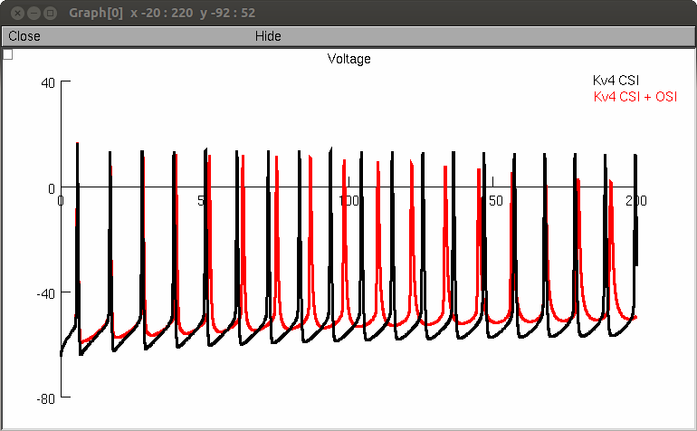
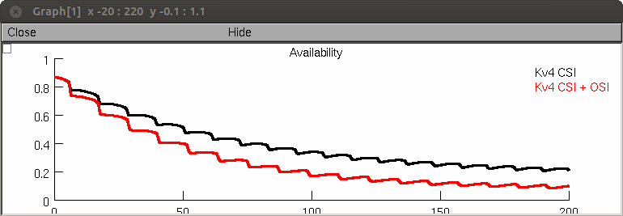

# CA1 Pyramidal Neuron Model and IonChannelLab Simulations from the Paper

J.D. Fineberg, D.M. Ritter and M. Covarrubias  
Modeling-independent elucidation of inactivation pathways in  
recombinant and native A-type Kv channels. *J Gen Physiol* 2012

These models predict the differential effects of having varying pathways of inactivation. Model of CA1 pyramidal neuron from Migliore et al (1999; ModelDB accession #2796) with the A-type potassium current replaced by Markov models of Kv4 channels.

As in the paper, in file names:  
- CSI = closed state inactivation  
- OSI = open state inactivation  
- CSIOSI = combined CSI and OSI

## To Reproduce Figures

### Figure 2, 3, and 4
1. Open folder "IonChannelLab files"  
2. Open .ichl file of channel interested in  
3. Click "Simulations" tab  
4. Underneath "Experiments" select experiment interested in  
5. Click Run

### Figure 11C
1. Open "Figure11C CSI.hoc" and click "Run Figure 11C CSI"  
2. Open "Figure11C CSIOSI.hoc" and click "Run Figure 11C CSI+OSI"

### Figure 11D
1. Open "Figure11D.hoc" and click "Run Figure 11D"

### Figure 11E-G
1. Open "Figure11E.hoc" and click "Run Figure 11E"

"Auto Launch" (will start the mosinit.hoc file if you have NEURON installed and your browser is properly configured) to recreate Figure 11E. Press "Run Figure11E" and in a minute you should see graphs like:

  

To load figures 11C, 11D, and the channel simulations the entire folder must be downloaded and opened. Figures 11A & B can be simulated creating single compartment models with Kv4 CSI or Kv4 CSI+OSI and using the vClamp family or the grapher function for current families and SSI, respectively.

Any questions may be directed to david.ritter@jefferson.edu

---

2025-07-09: Converted README to Markdown.